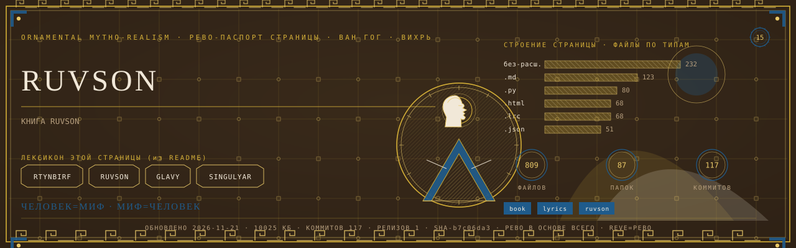

# КНИГА RUVSON

  

<!--ФОРЖ:МУЗА:НАЧАЛО-->

  
   
  

<!--ФОРЖ:МУЗА:КОНЕЦ-->

<!--ФОРЖ:ПАСПОРТ:НАЧАЛО-->

  

| ФАЙЛОВ | ПАПОК | КОММИТОВ | ОБНОВЛЕНО | РЕЛИЗОВ |
|---:|---:|---:|---|---:|
| 803 | 87 | 80 | 2026-11-19 | 1 |
<!--ФОРЖ:ПАСПОРТ:КОНЕЦ-->

> Собрана 2026-11-11 из 6 репозиториев аккаунта rtynbirf. Каждая глава — снимок `main` оригинала на дату сборки (см. `PROVENANCE.md` внутри главы). Оригиналы архивированы read-only, история коммитов сохранена там.

## Оглавление

| Глава | Источник | Файлов | Коммитов в ориг. | Снимок |
|---|---|---|---|---|
| [ruvson-lyrics](glavy/ruvson-lyrics/) | [оригинал](https://github.com/rtynbirf/ruvson-lyrics) | 407 | 58 | `37c34cf` |
| [ruvson-rse2](glavy/ruvson-rse2/) | [оригинал](https://github.com/rtynbirf/ruvson-rse2) | 67 | 0 | `0f1b353` |
| [karaoke-dream](glavy/karaoke-dream/) | [оригинал](https://github.com/rtynbirf/karaoke-dream) | 61 | 0 | `7a46e9c` |
| [rumu](glavy/rumu/) | [оригинал](https://github.com/rtynbirf/rumu) | 12 | 27 | `ef463f1` |
| [singulyar-llm](glavy/singulyar-llm/) | [оригинал](https://github.com/rtynbirf/singulyar-llm) | 32 | 59 | `2132443` |
| [voice-atlas-llm](glavy/voice-atlas-llm/) | [оригинал](https://github.com/rtynbirf/voice-atlas-llm) | 202 | 97 | `5f4718d` |

## О чём эта книга

Книга: песенная вселенная RUVSON/СИНГУЛЯР одним томом — тексты 65 треков, станок RSE-2, караоке-дрим, РУМУ, локальная модель, атлас голоса. Собрано из 6 репозиториев rtynbirf.

## Как читать

Каждый каталог в `glavy/` — самостоятельная глава со своим README (если оно было в оригинале). Оглавление главы не переименовывалось: имена совпадают с именами исходных репозиториев, чтобы работали старые ссылки в документах.

## Канон

**Живая вселенная песни — вне книги**: репозиторий [singulyar](https://github.com/rtynbirf/singulyar) · сайт https://rtynbirf.github.io/singulyar/ — 64 песни × 200 языков, фонд минусовок, караоке-дом. Эта книга — мастерские: тексты, станок, модель, атлас голоса.

## Как читать книгу

- Каждая глава (`glavy/<глава>/`) — снимок `main` оригинала на дату сборки; происхождение и SHA снимка — в `PROVENANCE.md` внутри главы.
- Правки — только в оригиналах (ссылки в оглавлении выше); оригиналы архивированы read-only, история коммитов сохранена в них.
- Ядро дома — [polymath-core](https://github.com/rtynbirf/polymath-core); живой реестр аккаунта — [index](https://github.com/rtynbirf/index).
- Онлайн-версия тома: https://rtynbirf.github.io/ruvson/
- Лицензия тома — MIT ([LICENSE](LICENSE)); у каждой главы — лицензия её оригинала.

<!--ФОРЖ:ПОДВАЛ-->
---

  ◆ картина и штандарт — ручная ковка <a href="https://github.com/rtynbirf">КУЗНИ ПОЛИМАТ</a> · ЧЕЛОВЕК=АККАУНТ=PID1 ◆

